<div align="center">

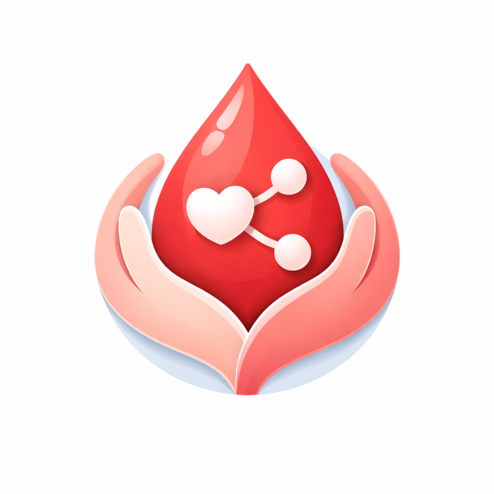

# 🩸 Wareed — وريد

### *Connecting Blood Donors with Those Who Need It Most*

> **Portfolio case study:** [akoding.dev](https://akoding.dev/#projects) · **Status:** personal open-source Flutter project.
>
> This repository is intended as a code sample. Configure your own Supabase, Firebase, and Google Maps credentials before running it; never commit production credentials.

[](https://flutter.dev)
[](https://dart.dev)
[](https://supabase.com)
[](https://firebase.google.com)
[](https://riverpod.dev)
[](https://pub.dev/packages/google_maps_flutter)
[](https://github.com)
[](https://flutter.dev)
[](https://pub.dev/packages/easy_localization)
[](https://flutter.dev)
[](https://github.com)

</div>

---

## 📖 About

**Wareed** (وريد — Arabic for *blood vessel*) is a production-ready, full-featured blood donation coordination platform built with Flutter. It bridges the gap between blood donors and patients in urgent need by providing real-time maps, smart matching, and a comprehensive inventory system for blood centers.

> 🇸🇾 Currently focused on **Syria**, with support for **14 cities** and **20+ blood centers** in Damascus.

---

## ✨ Features

### 🧑‍🤝‍🧑 Three User Roles

<table>
  <tr>
    <th>🩸 Donor</th>
    <th>🏥 Receiver</th>
    <th>⚙️ Admin</th>
  </tr>
  <tr>
    <td>
      • Personal donation dashboard<br/>
      • Deferral countdown tracker<br/>
      • Nearby receivers map<br/>
      • Donation history<br/>
      • Points & leaderboard<br/>
      • Real-time availability toggle
    </td>
    <td>
      • Interactive donor map<br/>
      • Filter by blood type<br/>
      • Donor contact & messaging<br/>
      • Proximity-based search<br/>
      • Real-time donor list<br/>
      • Blood type quick selector
    </td>
    <td>
      • Blood inventory dashboard<br/>
      • Low stock alerts<br/>
      • Priority / urgent requests<br/>
      • Donor reward management<br/>
      • Multi-center oversight<br/>
      • Inventory quantity updates
    </td>
  </tr>
</table>

### 🌟 Shared Capabilities

- 🗺️ **Google Maps** integration with custom markers
- 🔔 **Push Notifications** via Firebase Cloud Messaging
- 🌐 **Bilingual** — Arabic (default) + English
- 🌙 **Dark & Light Mode**
- 📍 **GPS Location** services
- 🏛️ **Blood Centers Directory** across Syria
- 🔐 **Secure Auth** via Supabase
- ⚡ **Real-time** data updates

---

## 📸 Screenshots

<p align="center">
  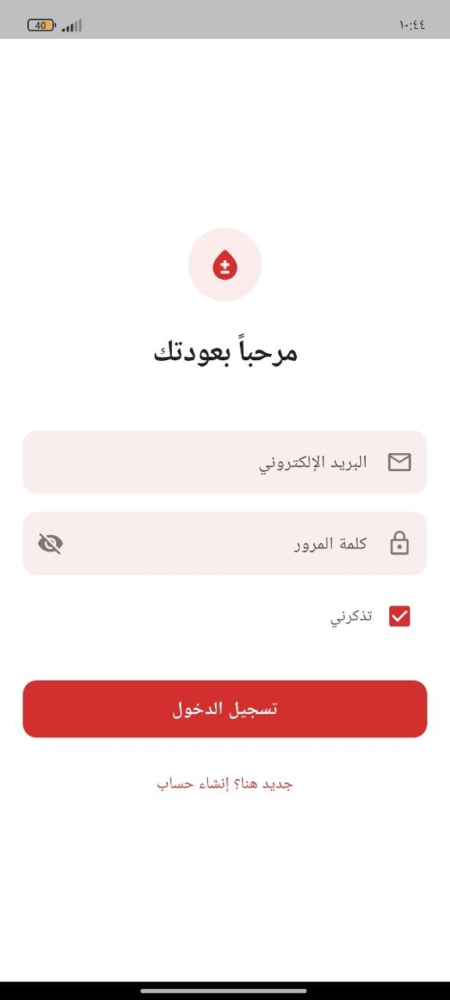
</p>
<p align="center"><strong>🔐 Login Screen</strong></p>

### 🩸 Donor Experience
<p align="center">
  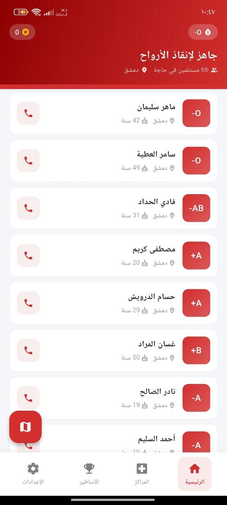
  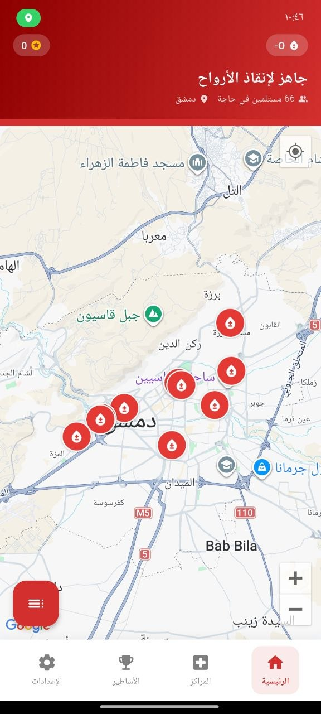
  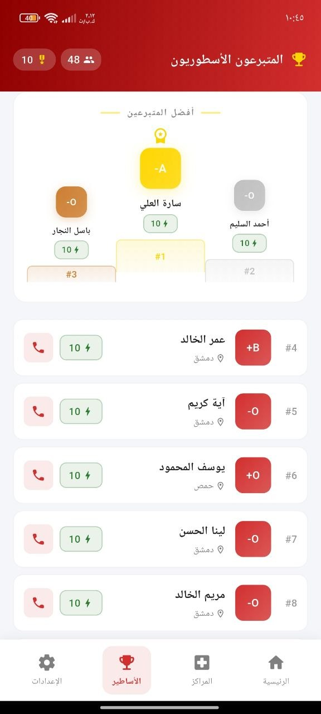
</p>
<p align="center">
  <strong>Home</strong> &nbsp;&nbsp;&nbsp;&nbsp;&nbsp;&nbsp;&nbsp;&nbsp;&nbsp;&nbsp;&nbsp;&nbsp;&nbsp;&nbsp;&nbsp;&nbsp;&nbsp;&nbsp;&nbsp;&nbsp;&nbsp;&nbsp;&nbsp;&nbsp;&nbsp;
  <strong>Map View</strong> &nbsp;&nbsp;&nbsp;&nbsp;&nbsp;&nbsp;&nbsp;&nbsp;&nbsp;&nbsp;&nbsp;&nbsp;&nbsp;&nbsp;&nbsp;&nbsp;&nbsp;&nbsp;&nbsp;&nbsp;&nbsp;
  <strong>Leaderboard</strong>
</p>

### 🏥 Receiver Experience
<p align="center">
  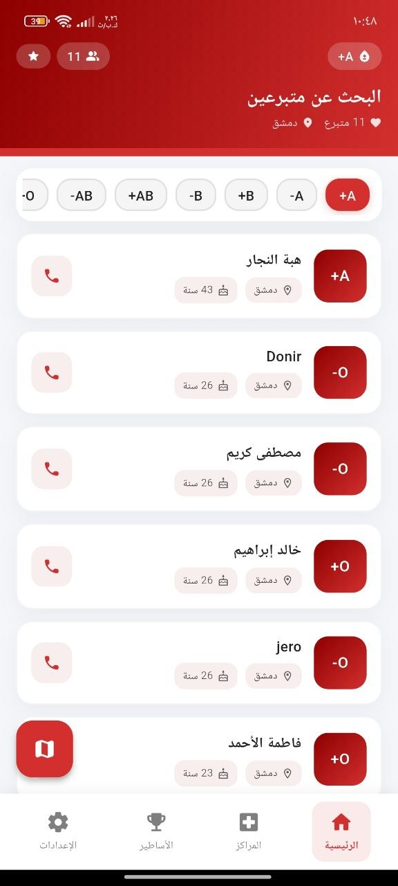
  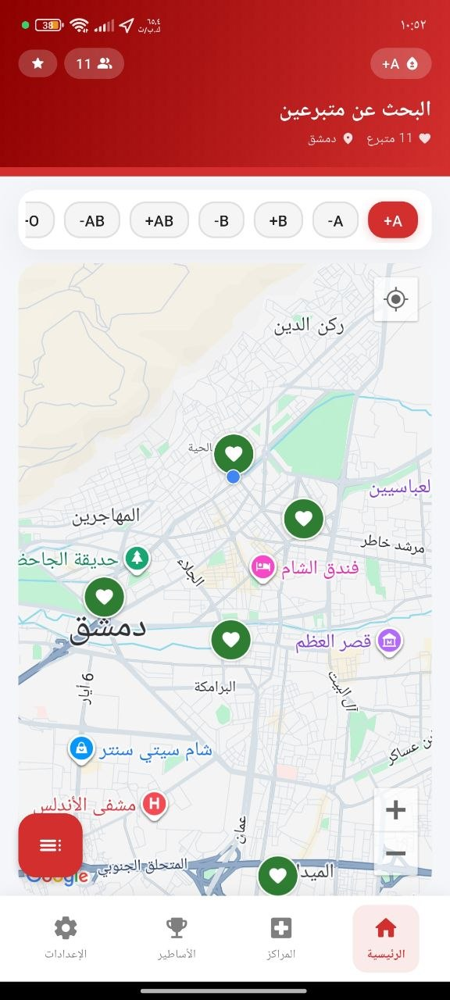
  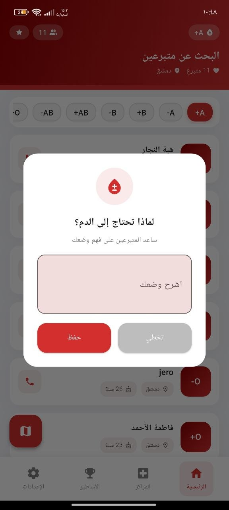
</p>
<p align="center">
  <strong>Home</strong> &nbsp;&nbsp;&nbsp;&nbsp;&nbsp;&nbsp;&nbsp;&nbsp;&nbsp;&nbsp;&nbsp;&nbsp;&nbsp;&nbsp;&nbsp;&nbsp;&nbsp;&nbsp;&nbsp;&nbsp;&nbsp;&nbsp;&nbsp;&nbsp;&nbsp;
  <strong>Map View</strong> &nbsp;&nbsp;&nbsp;&nbsp;&nbsp;&nbsp;&nbsp;&nbsp;&nbsp;&nbsp;&nbsp;&nbsp;&nbsp;&nbsp;&nbsp;&nbsp;&nbsp;&nbsp;&nbsp;&nbsp;&nbsp;
  <strong>Donor Details</strong>
</p>

### 🏛️ Blood Centers
<p align="center">
  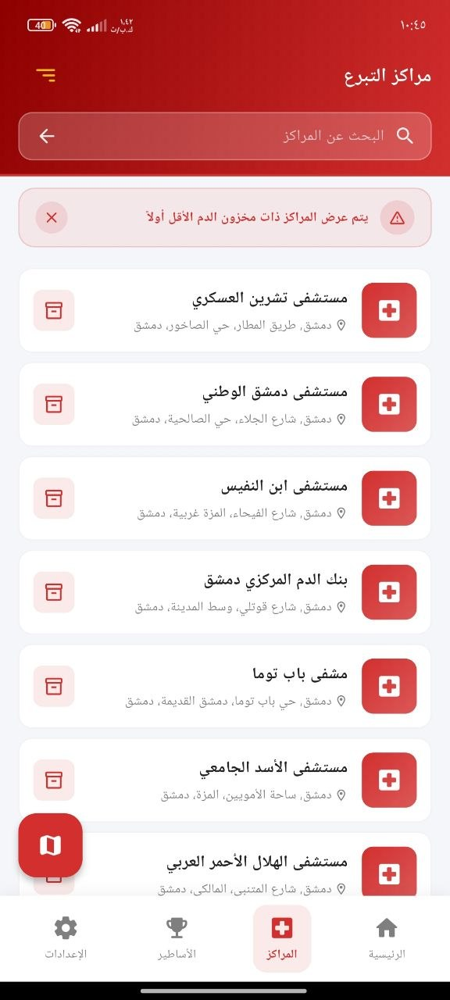
  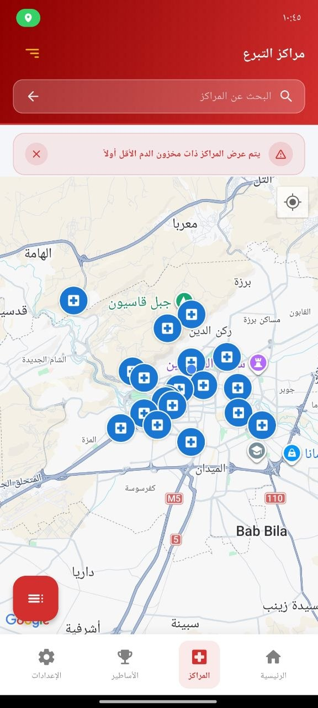
</p>
<p align="center">
  <strong>Centers List</strong> &nbsp;&nbsp;&nbsp;&nbsp;&nbsp;&nbsp;&nbsp;&nbsp;&nbsp;&nbsp;&nbsp;&nbsp;&nbsp;&nbsp;&nbsp;&nbsp;&nbsp;&nbsp;&nbsp;&nbsp;&nbsp;&nbsp;&nbsp;
  <strong>Map View</strong>
</p>

### ⚙️ Admin & Settings
<p align="center">
  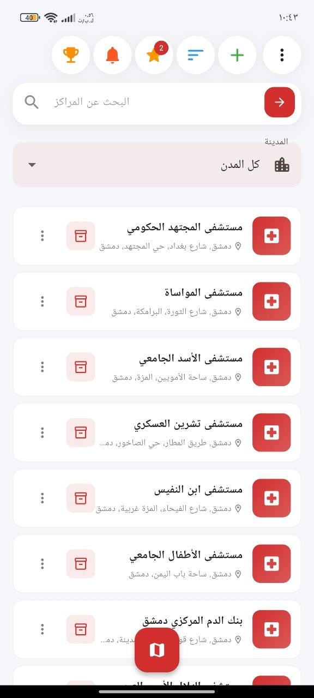
  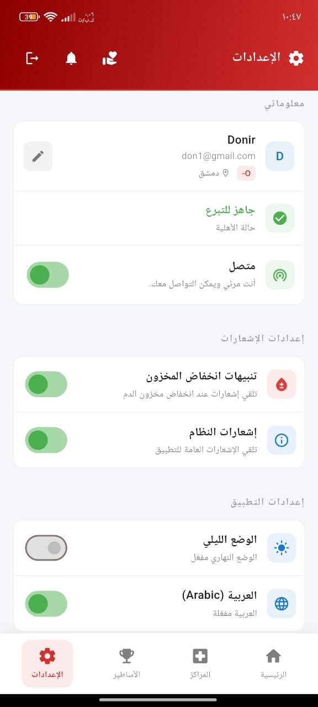
</p>
<p align="center">
  <strong>Admin Dashboard</strong> &nbsp;&nbsp;&nbsp;&nbsp;&nbsp;&nbsp;&nbsp;&nbsp;&nbsp;&nbsp;&nbsp;&nbsp;&nbsp;&nbsp;&nbsp;&nbsp;&nbsp;&nbsp;&nbsp;
  <strong>Settings</strong>
</p>

---

## 🏗️ Architecture

The project follows **Clean Architecture** with a **feature-first** folder structure:

```
lib/
├── core/                    # Shared infrastructure
│   ├── constants/           # Blood types, Syrian cities
│   ├── models/              # Shared data models
│   ├── notifications/       # FCM templates
│   ├── services/            # Background services
│   ├── theme/               # Colors, typography, dark/light
│   └── widgets/             # Reusable UI components
│
└── features/
    ├── admin/               # Admin dashboard & inventory
    ├── donor/               # Donor dashboard & leaderboard
    ├── receiver/            # Map-based donor finder
    └── shared/              # Auth, centers, notifications, settings
```

**State Management:** [Riverpod v2](https://riverpod.dev) with code generation  
**Backend:** [Supabase](https://supabase.com) (PostgreSQL + Realtime + Auth)  
**Notifications:** [Firebase Cloud Messaging](https://firebase.google.com/docs/cloud-messaging)  
**Maps:** [Google Maps Flutter](https://pub.dev/packages/google_maps_flutter)

### 📂 Full Folder Structure

```
lib/
│
├── main.dart
├── firebase_options.dart
│
├── core/                                         # Shared infrastructure
│   ├── constants/
│   │   ├── app_constants.dart
│   │   └── supabase_constants.dart
│   ├── layout/
│   │   └── main_layout.dart
│   ├── models/
│   │   └── blood_center_model.dart
│   ├── notifications/
│   │   └── notification_templates.dart
│   ├── providers/
│   │   └── navigation_provider.dart
│   ├── services/
│   │   ├── background_message_handler.dart
│   │   └── fcm_service.dart
│   ├── theme/
│   │   ├── app_colors.dart
│   │   ├── app_spacing.dart
│   │   ├── app_theme.dart
│   │   └── app_typography.dart
│   ├── utils/
│   │   ├── api_logger.dart
│   │   ├── app_logger.dart
│   │   ├── blood_utils.dart
│   │   ├── map_marker_helper.dart
│   │   └── sorting_utils.dart
│   └── widgets/
│       ├── app_confirm_dialog.dart
│       ├── app_loading_indicator.dart
│       ├── custom_loader.dart
│       ├── donor_detail_sheet.dart
│       ├── info_bottom_sheet.dart
│       ├── map_toggle_fab.dart
│       └── user_card.dart
│
├── features/
│   │
│   ├── admin/
│   │   ├── donor_rewards/
│   │   │   └── presentation/screens/
│   │   │       └── admin_donor_rewards_screen.dart
│   │   ├── home/
│   │   │   ├── data/repositories/
│   │   │   │   └── admin_home_repository_impl.dart
│   │   │   ├── domain/
│   │   │   │   ├── entities/admin_home_entity.dart
│   │   │   │   └── repositories/admin_home_repository.dart
│   │   │   └── presentation/
│   │   │       ├── providers/admin_home_provider.dart
│   │   │       └── screens/admin_home_screen.dart
│   │   ├── inventory/
│   │   │   ├── data/
│   │   │   │   ├── inventory_service.dart
│   │   │   │   ├── low_stock_alert_service.dart
│   │   │   │   └── repositories/inventory_repository_impl.dart
│   │   │   ├── domain/
│   │   │   │   ├── entities/inventory_entity.dart
│   │   │   │   └── repositories/inventory_repository.dart
│   │   │   └── presentation/
│   │   │       ├── providers/inventory_provider.dart
│   │   │       └── screens/center_inventory_screen.dart
│   │   └── priority_mgmt/
│   │       ├── data/
│   │       │   ├── priority_service.dart
│   │       │   └── repositories/priority_repository_impl.dart
│   │       ├── domain/
│   │       │   ├── entities/priority_request_entity.dart
│   │       │   └── repositories/priority_repository.dart
│   │       └── presentation/
│   │           ├── providers/priority_provider.dart
│   │           └── screens/admin_priority_screen.dart
│   │
│   ├── donor/
│   │   ├── dashboard/
│   │   │   ├── data/donor_dashboard_service.dart
│   │   │   └── presentation/
│   │   │       ├── providers/
│   │   │       │   ├── deferral_timer_provider.dart
│   │   │       │   ├── donor_dashboard_provider.dart
│   │   │       │   ├── donor_profile_provider.dart
│   │   │       │   └── receiver_list_provider.dart
│   │   │       ├── screens/donor_dashboard_screen.dart
│   │   │       └── widgets/
│   │   │           ├── deferral_view.dart
│   │   │           ├── donor_header.dart
│   │   │           ├── receiver_card.dart
│   │   │           └── receiver_list.dart
│   │   └── leaderboard/
│   │       ├── data/leaderboard_service.dart
│   │       └── presentation/
│   │           ├── providers/leaderboard_provider.dart
│   │           ├── screens/leaderboard_screen.dart
│   │           └── widgets/
│   │               ├── podium_section.dart
│   │               └── rank_list_item.dart
│   │
│   ├── receiver/
│   │   └── map_finder/
│   │       ├── data/map_finder_service.dart
│   │       └── presentation/
│   │           ├── providers/receiver_map_provider.dart
│   │           ├── screens/receiver_map_screen.dart
│   │           └── widgets/
│   │               ├── receiver_blood_type_selector.dart
│   │               ├── receiver_donor_card.dart
│   │               ├── receiver_donor_list.dart
│   │               ├── receiver_donor_map.dart
│   │               ├── receiver_donor_sheet.dart
│   │               ├── receiver_home_app_bar.dart
│   │               └── receiver_home_states.dart
│   │
│   └── shared/
│       ├── auth/
│       │   ├── data/
│       │   │   ├── auth_service.dart
│       │   │   └── repositories/auth_repository_impl.dart
│       │   ├── domain/
│       │   │   ├── entities/
│       │   │   │   ├── auth_state_entity.dart
│       │   │   │   └── user_entity.dart
│       │   │   └── repositories/auth_repository.dart
│       │   ├── presentation/
│       │   │   ├── providers/auth_provider.dart
│       │   │   ├── screens/
│       │   │   │   ├── login_screen.dart
│       │   │   │   ├── onboarding_screen.dart
│       │   │   │   ├── signup_screen.dart
│       │   │   │   └── splash_screen.dart
│       │   │   └── widgets/
│       │   │       ├── auth_header.dart
│       │   │       ├── auth_text_field.dart
│       │   │       ├── donor_rules_dialog.dart
│       │   │       ├── password_field.dart
│       │   │       ├── remember_me_toggle.dart
│       │   │       └── user_type_selector.dart
│       │   └── utils/
│       │       ├── auth_error_mapper.dart
│       │       └── auth_validators.dart
│       ├── centers_list/
│       │   └── presentation/
│       │       ├── providers/centers_provider.dart
│       │       ├── screens/
│       │       │   ├── centers_screen.dart
│       │       │   └── location_picker_screen.dart
│       │       └── widgets/
│       │           ├── admin_center_dialog.dart
│       │           ├── blood_stock_tile.dart
│       │           ├── center_card.dart
│       │           ├── centers_list.dart
│       │           └── centers_map.dart
│       ├── notifications/
│       │   ├── data/notifications_service.dart
│       │   └── presentation/screens/notifications_screen.dart
│       └── settings/
│           ├── data/
│           │   ├── settings_service.dart
│           │   ├── models/notification_settings_model.dart
│           │   └── repositories/
│           │       ├── notification_settings_repository_impl.dart
│           │       └── settings_repository_impl.dart
│           ├── domain/
│           │   ├── entities/
│           │   │   ├── eligibility_entity.dart
│           │   │   ├── notification_settings_entity.dart
│           │   │   └── user_profile_entity.dart
│           │   ├── repositories/
│           │   │   ├── notification_settings_repository.dart
│           │   │   └── settings_repository.dart
│           │   └── usecases/
│           │       ├── get_donation_history.dart
│           │       ├── get_user_profile.dart
│           │       ├── toggle_availability.dart
│           │       └── update_user_profile.dart
│           └── presentation/
│               ├── providers/
│               │   ├── availability_provider.dart
│               │   ├── donation_history_provider.dart
│               │   ├── notification_settings_provider.dart
│               │   ├── profile_provider.dart
│               │   └── theme_provider.dart
│               ├── screens/
│               │   ├── donation_history_screen.dart
│               │   ├── edit_profile_screen.dart
│               │   └── settings_screen.dart
│               └── widgets/
│                   ├── availability_toggle.dart
│                   ├── donation_history_list.dart
│                   ├── eligibility_timer.dart
│                   ├── language_switcher.dart
│                   ├── priority_request_card.dart
│                   ├── profile_card.dart
│                   ├── settings_section.dart
│                   └── theme_switcher.dart
│
└── references/                                   # Design patterns & templates
    ├── button_patterns.dart
    ├── glass_container.dart
    └── screen_templates.dart
```

---

## 🚀 Getting Started

### Prerequisites

- Flutter `3.x` or higher
- Dart `3.0+`
- A [Supabase](https://supabase.com) project
- A [Firebase](https://console.firebase.google.com) project (for push notifications)
- Google Maps API key

### Installation

```bash
# 1. Clone the repository
git clone https://github.com/Ahmaddoolt/bloody
cd bloody

# 2. Install dependencies
flutter pub get

# 3. Run code generation
dart run build_runner build --delete-conflicting-outputs

# 4. Run the app
flutter run
```

### Configuration

1. **Supabase** — Add your `SUPABASE_URL` and `SUPABASE_ANON_KEY` to the project config.
2. **Firebase** — Place your `google-services.json` (Android) and `GoogleService-Info.plist` (iOS) in the respective platform folders.
3. **Google Maps** — Add your API key to `AndroidManifest.xml` and `AppDelegate.swift`.
4. **Seed the database** — Run `supabase_seed.sql` on your Supabase instance to populate cities and blood centers.

---

## 🔔 Notification Setup

See [NOTIFICATION_SETUP.md](NOTIFICATION_SETUP.md) for full instructions on configuring push notification icons, channels, and templates.

Available notification types:
| Type | Trigger |
|------|---------|
| 🩸 Blood Request | Urgent donor needed |
| 🚨 Low Stock Alert | Inventory below threshold |
| 🔴 Priority Request | Emergency case |
| ✅ Appointment Confirmed | Booking success |
| 📅 Eligibility Reminder | Next donation available |
| 🙏 Donation Thanks | Post-donation gratitude |

---

## 🛠️ Tech Stack

| Category | Technology |
|----------|-----------|
| Framework | Flutter + Dart |
| State Management | Riverpod 2 |
| Backend | Supabase (PostgreSQL + Realtime) |
| Notifications | Firebase Cloud Messaging |
| Maps | Google Maps Flutter |
| Location | Geolocator + Geocoding |
| i18n | Easy Localization (AR / EN) |
| Local Storage | Shared Preferences |

---

## 🤝 Contributing

Contributions are welcome! Please open an issue first to discuss your proposed change, then submit a pull request.

```bash
git checkout -b feature/your-feature-name
git commit -m "feat: add your feature"
git push origin feature/your-feature-name
```

---

<div align="center">
  Made with ❤️ and 🩸 — because every donation saves a life.
</div>
